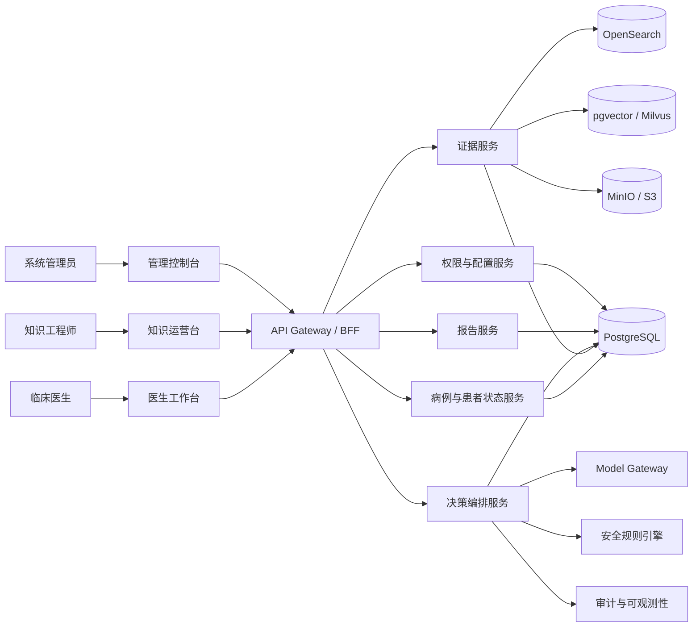
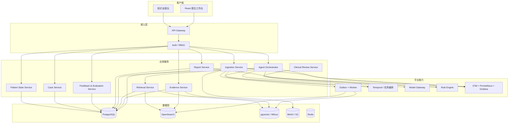
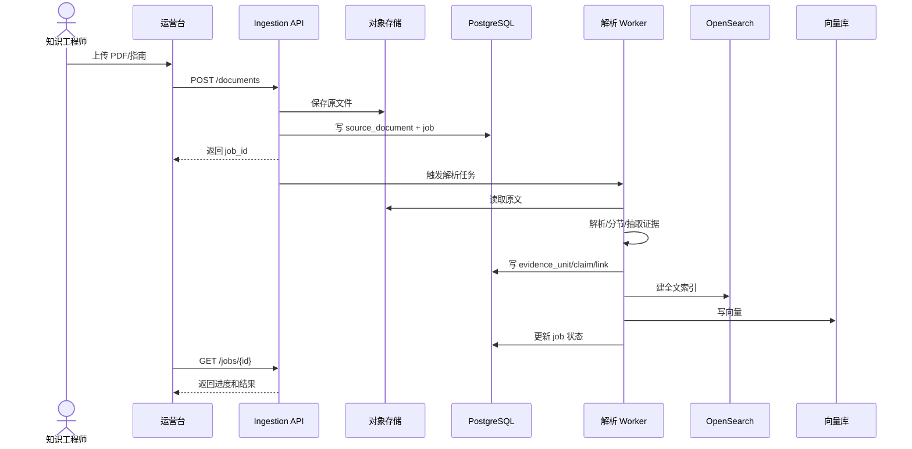
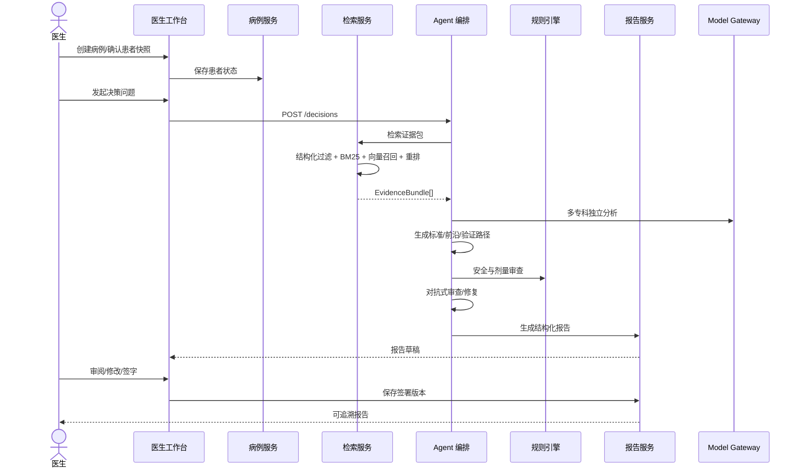

# 医疗智能体项目全景

> 工作代号：MedEvidence Copilot  
> 文档版本：V0.2  
> 定位：复杂肿瘤病例的循证临床决策支持系统

---

## 1. 项目概述

### 1.1 项目定位

MedEvidence Copilot 是一个面向临床医生的循证决策支持系统。系统把医学文献、临床指南、药品说明书和患者病历转化为结构化证据与患者状态，再通过多专科 Agent、证据适用性匹配、安全规则和对抗式审查，生成可追溯的临床决策材料。

**一句话定位：**

> 不是替代医生的医疗大模型，而是把顶级专家的证据检索、方案比较、风险审查和复盘流程工程化。

### 1.2 核心目标

1. 将非结构化医学文献转化为**可检索、可审查、可追溯**的证据单元；
2. 将患者病历转化为**动态更新的患者状态快照**；
3. 针对复杂病例生成：
   - 标准路径；
   - 前沿路径；
   - 验证任务；
   - 安全风险与监测建议；
   - 证据引用与不确定性说明；
4. 支持医生审阅、修改、签字和反馈；
5. 形成“方案 → 真实结局”的复盘闭环。

### 1.3 非目标

首期明确不做：

- 不自动诊断；
- 不自动开处方；
- 不替代医生签字；
- 不直接面向患者给出治疗建议；
- 不覆盖急诊、儿科、妊娠等高风险场景，除非另行完成专项验证；
- 不在没有证据溯源的情况下生成确定性结论；
- 不把通用大模型作为唯一安全判断依据。

### 1.4 目标用户

| 用户 | 主要诉求 |
|---|---|
| 肿瘤内科医生 | 复杂病例的治疗选择、证据查询、方案比较 |
| 胸外科医生 | 手术时机、可切除性、围手术期风险 |
| 呼吸科医生 | 合并症、间质性肺病、感染风险 |
| 临床药师 | 剂量、相互作用、禁忌和不良反应 |
| MDT 团队 | 会诊材料准备、分歧点整理 |
| 知识工程师 | 证据抽取、标注、审核、版本维护 |
| 医务/质控 | 审计、权限、安全事件追溯 |
| 管理员 | 模型、规则、索引、用户和配置管理 |

### 1.5 首期场景

建议首期聚焦：

> **肺癌单病种、复杂/灰区病例、医生辅助、回顾性评测 + 影子模式。**

典型问题：

- 晚期肺癌一线治疗选择；
- 基因检测结果未明时的治疗顺序；
- 合并间质性肺病等特殊合并症时的用药安全；
- 靶向、免疫、化疗的排序；
- 手术、放疗、系统治疗的先后关系；
- 需要补充哪些检查才能改变决策。

---

## 2. 核心功能

| 模块 | 功能 | 优先级 |
|---|---|---|
| 文档导入 | PDF/HTML/图片/结构化数据导入、任务进度 | P0 |
| 知识生产 | 解析、证据抽取、PICO 标注、原文溯源、人工审核 | P0 |
| 证据检索 | 结构化过滤 + 关键词 + 向量混合检索 | P0 |
| 患者状态 | 病例录入、事件抽取、时间线、状态快照、医生确认 | P0 |
| 多专科 Agent | 专科独立意见、结构化输出、分歧保留 | P1 |
| 路径生成 | 标准路径、前沿路径、验证任务 | P0 |
| 安全审查 | 禁忌、剂量、相互作用、尾部风险、时序、边际价值 | P0 |
| 报告生成 | 结构化报告、引用、风险、待查项 | P0 |
| 医生工作台 | 审阅、修改、驳回、签字、批注 | P0 |
| 审计与回放 | 版本、证据、模型、提示词、报告快照 | P0 |
| 反馈闭环 | 医生反馈、真实结局、离线评测 | P1 |
| 权限管理 | RBAC/ABAC、租户/科室隔离 | P0 |

---

## 3. 系统架构总览

### 3.1 上下文图



### 3.2 容器图



### 3.3 分层职责

| 层 | 职责 |
|---|---|
| 接入层 | 认证、鉴权、限流、审计、路由 |
| 应用层 | 病例、知识、检索、Agent、审查、报告、反馈 |
| 领域层 | 证据单元、Claim、EvidenceBundle、患者快照、路径、审查发现 |
| 数据层 | PostgreSQL、对象存储、OpenSearch、向量库、Redis |
| 平台层 | 工作流、Outbox、模型网关、规则引擎、可观测性 |
| 安全层 | RBAC/ABAC、脱敏、加密、审计、数据生命周期 |

---

## 4. 技术栈

> 版本以项目锁文件为准，以下为推荐基线。

| 类别 | 推荐选型 | 说明 |
|---|---|---|
| 后端 | Python 3.11 + FastAPI + Pydantic v2 | 异步 API、类型校验 |
| ORM/迁移 | SQLAlchemy 2 + Alembic | 数据模型和版本迁移 |
| Agent 编排 | LangGraph | 有状态 Agent 工作流 |
| 长任务 | Celery + Redis 或 Temporal | 文档导入、重索引、评测 |
| 关系库 | PostgreSQL 16 | 事实源、元数据、版本、权限 |
| 向量 | pgvector 起步，Milvus 扩展 | 语义召回 |
| 全文检索 | OpenSearch 2.x | BM25、中文分词、过滤、高亮 |
| 对象存储 | MinIO / S3 / OSS | 原始文件和快照 |
| 缓存 | Redis 7 | 会话、热点缓存、限流 |
| PDF 解析 | MinerU + PaddleOCR 兜底 | 复杂版面、表格、公式 |
| Embedding | BGE-M3 或医疗领域 embedding | 支持稠密+稀疏 |
| Reranker | BGE-Reranker | 检索重排序 |
| LLM | 统一 Model Gateway | Qwen/DeepSeek/GPT/Claude/本地模型 |
| 前端 | React 18 + TypeScript + Ant Design | 医生工作台 |
| 可观测 | OpenTelemetry + Prometheus + Grafana + Loki | 链路、指标、日志 |
| 部署 | Docker Compose 起步，K8s 生产扩展 | 私有化和弹性 |

---

## 5. 目录结构

```text
medevidence/
├── backend/
│   ├── app/
│   │   ├── api/
│   │   │   ├── v1/
│   │   │   │   ├── auth.py
│   │   │   │   ├── cases.py
│   │   │   │   ├── patients.py
│   │   │   │   ├── documents.py
│   │   │   │   ├── jobs.py
│   │   │   │   ├── evidence.py
│   │   │   │   ├── claims.py
│   │   │   │   ├── decisions.py
│   │   │   │   ├── reports.py
│   │   │   │   └── feedback.py
│   │   │   └── deps.py
│   │   ├── core/
│   │   │   ├── config.py
│   │   │   ├── security.py
│   │   │   ├── logging.py
│   │   │   └── exceptions.py
│   │   ├── domain/
│   │   │   ├── evidence/
│   │   │   ├── claim/
│   │   │   ├── patient/
│   │   │   ├── decision/
│   │   │   ├── review/
│   │   │   └── report/
│   │   ├── application/
│   │   │   ├── ingestion/
│   │   │   ├── retrieval/
│   │   │   ├── agents/
│   │   │   ├── review/
│   │   │   ├── reporting/
│   │   │   └── feedback/
│   │   ├── infrastructure/
│   │   │   ├── db/
│   │   │   ├── search/
│   │   │   ├── vector/
│   │   │   ├── object_storage/
│   │   │   ├── llm/
│   │   │   ├── rules/
│   │   │   └── observability/
│   │   ├── workers/
│   │   └── main.py
│   ├── alembic/
│   ├── tests/
│   │   ├── unit/
│   │   ├── integration/
│   │   ├── contract/
│   │   └── evaluation/
│   ├── pyproject.toml
│   └── Dockerfile
├── frontend/
│   ├── src/
│   │   ├── pages/
│   │   ├── components/
│   │   ├── features/
│   │   ├── api/
│   │   └── store/
│   └── package.json
├── deploy/
│   ├── docker-compose.yml
│   ├── k8s/
│   └── env/
├── docs/
├── scripts/
├── Makefile
└── README.md
```

---

## 6. 数据处理流程

### 6.1 文档导入流程



### 6.2 临床决策流程



---

## 7. API 概览

详细定义见 [05_API接口规范.md](05_API接口规范.md)。

| 方法 | 路径 | 说明 |
|---|---|---|
| POST | `/api/v1/auth/login` | 登录 |
| POST | `/api/v1/cases` | 创建病例 |
| GET | `/api/v1/cases/{case_id}` | 获取病例 |
| POST | `/api/v1/cases/{case_id}/snapshots` | 创建患者状态快照 |
| POST | `/api/v1/documents` | 上传文档 |
| GET | `/api/v1/jobs/{job_id}` | 查询任务 |
| GET | `/api/v1/evidence/search` | 检索证据 |
| GET | `/api/v1/claims/{claim_id}/bundle` | 获取证据包 |
| POST | `/api/v1/decisions` | 发起决策 |
| GET | `/api/v1/decisions/{id}/stream` | SSE 进度/结果流 |
| GET | `/api/v1/reports/{id}` | 获取报告 |
| POST | `/api/v1/reports/{id}/sign` | 医生签字 |
| POST | `/api/v1/feedback` | 反馈与结局回填 |

---

## 8. 快速开始

### 8.1 环境要求

| 项目 | 要求 |
|---|---|
| Python | 3.11+ |
| Node.js | 20+ |
| Docker | 24+ |
| PostgreSQL | 16+ |
| 内存 | 开发 16GB，建议 32GB |
| GPU | 本地 embedding/reranker 建议 8GB+ 显存 |

### 8.2 启动依赖

```bash
cp deploy/env/.env.example deploy/env/.env
docker compose -f deploy/docker-compose.yml up -d postgres opensearch minio redis
```

### 8.3 初始化数据库

```bash
cd backend
python -m venv .venv
source .venv/bin/activate   # Windows: .venv\Scripts\activate
pip install -e ".[dev]"
alembic upgrade head
python scripts/seed_dev.py
```

### 8.4 启动后端

```bash
uvicorn app.main:app --reload --host 0.0.0.0 --port 8000
```

### 8.5 启动前端

```bash
cd frontend
npm install
npm run dev
```

访问：

- 医生工作台：`http://localhost:5173`
- API 文档：`http://localhost:8000/docs`
- OpenSearch Dashboards：`http://localhost:5601`
- MinIO Console：`http://localhost:9001`

---

## 9. 首期范围与里程碑

| 阶段 | 目标 |
|---|---|
| P0 | 单病种、证据 schema、导入流水线、医生工作台原型 |
| P1 | 回顾性病例评测、证据包检索、基础安全规则 |
| P2 | 多专科 Agent、路径生成、五维审查 |
| P3 | 医院影子模式、审计、反馈闭环 |
| P4 | 前瞻性研究和合规申报评估 |

详细计划见 [08_项目计划与验收标准.md](08_项目计划与验收标准.md)。

---

## 10. 关键术语

| 术语 | 含义 |
|---|---|
| EvidenceUnit | 证据原子单元，一条证据表达一个主结论 |
| Claim | 规范化医学结论/命题 |
| EvidenceBundle | 针对一个 Claim 组织起来的证据包 |
| PatientSnapshot | 患者在某一时刻的临床状态快照 |
| Pathway | 标准路径/前沿路径/验证任务 |
| Critic | 对抗式审查器 |
| RAG | 检索增强生成 |
| PICO | 人群、干预、对照、结局 |
| PICOTS | PICO + 时间 + 研究场景 |
| SoT | Source of Truth，事实源 |
| HITL | Human-in-the-loop，人在环路 |

---

## 11. 评审修订补充（V0.2）

### 11.1 标注人员能力约束

证据抽取后必须由具备肿瘤临床背景的医学人员审核。算法工程师可以开发抽取流程，但不能单独决定医学证据是否入库。

### 11.2 输入病例准入

系统不得对信息严重不足的病例直接输出确定性方案。至少应满足：

- 有明确诊断和病种；
- 有当前治疗阶段/治疗线数；
- 有影响方案选择的关键合并症；
- 有影响安全性的关键器官功能；
- 关键待回报检查必须标记为 `pending`，不能当成阴性或正常。

不满足准入条件时，系统只输出“需要补充的信息/验证任务”，不输出最终推荐。

### 11.3 非目标补充

- 不输出针对个体的精确成功率、生存率或治愈概率；
- 不把群体研究结果直接等同于个体预后；
- 不替代检验科执行检查，不预判检查结果必然发生；
- 不替代医生做最终诊疗决策。

### 11.4 NFR 摘要

| 指标 | 试点目标 |
|---|---|
| 医生工作台可用性 | 99.5%+ |
| 证据检索 P95 | < 2s |
| 单次决策生成 | 1～5 分钟（异步） |
| 索引同步延迟 | < 5 分钟 |
| 严重安全规则误放行 | 0 |
| 历史报告回放 | 100% 可追溯 |

### 11.5 降级摘要

- OpenSearch 故障：降级为 PostgreSQL 精确过滤；
- 向量库故障：降级为关键词/结构化检索；
- LLM 故障：返回证据包和模板化摘要，不生成确定性推荐；
- 规则库缺失：阻断决策，要求人工复核；
- Outbox 积压：暂停新决策或进入只读降级，具体阈值由运维配置。

### 11.6 验证任务边界

“验证任务”只是建议医生补充哪些检查、结果可能如何影响方案，不代表系统能执行检查，也不代表检查结果一定按预期出现。
hello
world

