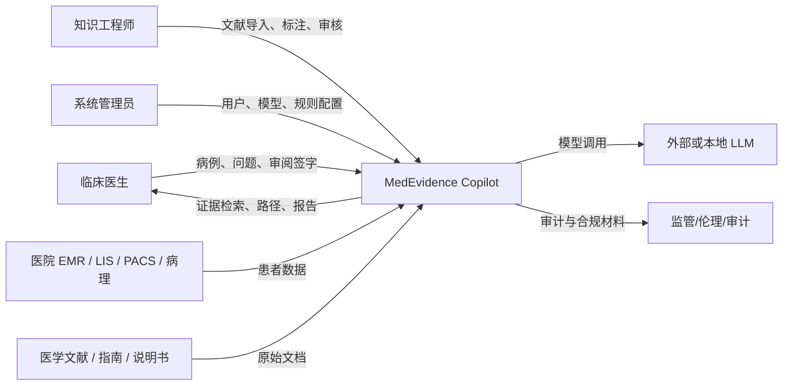
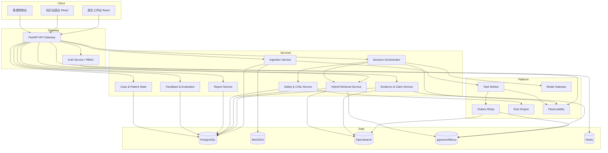
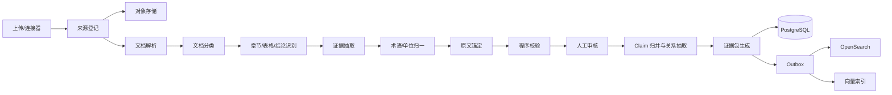
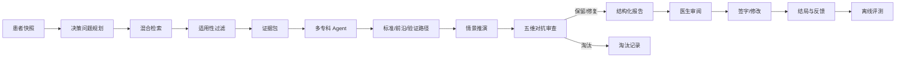

# 系统架构设计

> 文档版本：V0.2  
> 适用阶段：MVP 到试点部署  
> 目标：为研发、临床、数据、运维和安全团队提供统一的系统边界、模块职责和技术决策依据。

---

## 1. 架构目标与约束

### 1.1 架构目标

1. **可追溯**：每个推荐都能回到证据、患者状态、规则和模型版本。
2. **可审查**：系统不是黑盒，医生能看到证据、冲突、风险和不确定性。
3. **可替换**：LLM、embedding、reranker、向量库可以通过接口替换。
4. **可扩展**：从单病种扩展到多病种，从单院扩展到多院。
5. **可运维**：索引可重建、任务可重试、故障可降级。
6. **安全合规**：患者隐私、权限、审计、数据生命周期可控制。
7. **人机协同**：系统提出候选，医生做最终决策并签字。

### 1.2 关键约束

- 医疗数据高度敏感，默认私有化部署；
- 文献和指南存在版权、授权和版本问题；
- 临床安全规则不能只依赖 LLM；
- 首期数据量和标注能力有限，不宜追求全病种；
- 医生时间宝贵，报告必须结构化、短、可快速审阅；
- 监管路径未确定前，不做自主诊疗和自动处方。

---

## 2. C4 模型

### 2.1 System Context



### 2.2 Container Diagram



### 2.3 Component Diagram：知识生产



### 2.4 Component Diagram：临床决策



---

## 3. 服务职责

| 服务 | 职责 | 不负责 |
|---|---|---|
| API Gateway | 鉴权、路由、限流、审计、统一错误 | 业务推理 |
| Auth/RBAC | 用户、角色、租户、权限、数据范围 | 临床规则 |
| Case & Patient State | 病例、就诊、临床事件、快照、医生确认 | 文献检索 |
| Ingestion | 上传、解析、任务编排、抽取流水线 | 临床决策 |
| Evidence & Claim | 证据、Claim、关系、证据包、审核状态 | 模型调用 |
| Hybrid Retrieval | 过滤、BM25、向量、融合、重排 | 生成报告 |
| Decision Orchestrator | 决策问题、Agent 编排、路径生成、审查循环 | 数据存储 |
| Safety & Critic | 硬规则、剂量、禁忌、五维审查 | 替代医生 |
| Report | 报告生成、引用、签署、版本 | 证据抽取 |
| Feedback & Evaluation | 医生反馈、结局、评测集、指标 | 生产写入 |
| Model Gateway | 模型路由、重试、成本、限流、审计 | 临床逻辑 |
| Rule Engine | 确定性规则、规则版本、命中解释 | 自然语言生成 |

---

## 4. 关键数据流

### 4.1 知识入库链路

```text
上传 → 对象存储 → 解析 → 分类 → 分节/表格 → 证据抽取
→ 标准化 → 原文锚定 → 自动校验 → 人工审核
→ Claim 归并 → 关系抽取 → EvidenceBundle
→ PostgreSQL → Outbox → OpenSearch / 向量索引
```

### 4.2 查询链路

```text
临床问题 + 患者快照
→ 问题分解
→ 结构化过滤
→ BM25 关键词召回
→ 向量语义召回
→ 关系扩展
→ 融合与重排
→ 适用性判断
→ EvidenceBundle
→ 多专科 Agent
→ 路径生成
→ 安全/对抗审查
→ 报告
→ 医生签字
```

### 4.3 索引同步链路

```text
业务事务写 PostgreSQL
→ 同事务写 outbox_event
→ Relay 投递任务
→ Index Worker 更新 OpenSearch / 向量库
→ 更新 index_status
→ 失败重试 / 死信 / 对账
```

---

## 5. 存储架构

### 5.1 存储分工

| 存储 | 角色 | 权威性 |
|---|---|---|
| PostgreSQL | 证据、Claim、Bundle、患者状态、版本、权限、审计 | 事实源 |
| MinIO/S3 | PDF、HTML、图片、快照 | 原始内容事实源 |
| OpenSearch | 全文检索、过滤、排序、高亮 | 派生索引 |
| pgvector/Milvus | 语义向量召回 | 派生索引 |
| Redis | 会话、缓存、限流 | 临时数据 |
| 数据湖/数仓 | 离线评测、反馈、分析 | 分析副本 |
| Neo4j（可选） | 多跳证据关系 | 派生读模型 |

### 5.2 一致性策略

- 写入以 PostgreSQL 事务为准；
- 使用 Transactional Outbox 保证索引最终一致；
- 消费者幂等；
- 索引按版本重建；
- 检索返回 ID 后回 PostgreSQL 取权威数据；
- 报告保存证据版本和索引版本快照。

### 5.3 索引重建

```text
创建新索引 evidence_v2
→ 全量从 PostgreSQL/对象存储重建
→ 校验文档数和抽样结果
→ 别名 evidence_current 切换到 evidence_v2
→ 观察指标
→ 删除旧索引
```

---

## 6. Agent 架构

### 6.1 Agent 角色

| Agent | 职责 |
|---|---|
| 胸外科 Agent | 手术时机、可切除性、围手术期风险 |
| 呼吸科 Agent | 合并症、间质性肺病、感染风险 |
| 肿瘤内科 Agent | 系统治疗、靶向/免疫/化疗排序 |
| 临床药学 Agent | 剂量、相互作用、禁忌、不良反应 |
| 病理/影像 Agent | 诊断、分期、标志物解释 |
| 指南证据 Agent | 指南推荐、证据等级、适用性 |

### 6.2 Agent 输出协议

```json
{
  "specialty": "medical_oncology",
  "question": "一线治疗选择",
  "recommendation": "候选方案",
  "supporting_evidence_ids": ["E001", "E002"],
  "opposing_evidence_ids": ["E004"],
  "assumptions": ["基因结果待回报"],
  "missing_information": ["PD-L1 表达"],
  "safety_concerns": ["间质性肺病风险"],
  "confidence": "medium"
}
```

### 6.3 编排原则

- 每个 Agent 独立检索、独立输出；
- 使用结构化 schema，禁止自由聊天；
- 分歧保留，不取平均；
- 由独立汇总器识别冲突；
- 审查器只挑错，不推荐方案；
- 修复轮次上限 2～3 轮；
- 安全规则失败则拒绝输出推荐。

---

## 7. 安全与审查架构

### 7.1 确定性规则

适合规则引擎的内容：

- 禁忌证；
- 药物相互作用；
- 剂量上限；
- 肝肾功能调整；
- 过敏；
- 年龄/妊娠限制；
- 关键检查缺失；
- 治疗顺序硬约束。

### 7.2 LLM 审查

适合 LLM 的内容：

- 证据是否支持结论；
- 是否存在过度外推；
- 是否遗漏关键不确定性；
- 语言是否清晰；
- 是否存在逻辑跳跃。

### 7.3 五维审查

| 维度 | 目标 |
|---|---|
| 安全性 | 禁忌、相互作用、剂量、过敏 |
| 尾部风险 | 小概率严重后果和兜底方案 |
| 证据与剂量 | 证据支持、适用性、剂量正确 |
| 时序与执行 | 治疗顺序、时间窗、可执行性 |
| 边际价值 | 新增检查/药物是否改变决策 |

### 7.4 失败关闭

以下情况不得输出确定性推荐：

- 无证据支持；
- 关键安全规则冲突；
- 证据适用性无法判断；
- 患者关键字段缺失且影响决策；
- 审查发现 critical 问题未修复；
- 模型输出无法通过引用校验。

---

## 8. 非功能需求

### 8.1 可用性

- 医生工作台可用性目标：99.9%（试点期可 99.5%）；
- 索引故障时允许降级为 PostgreSQL 精确过滤；
- 模型不可用时保留已有报告和检索能力；
- 关键任务可重试、可恢复。

### 8.2 性能

| 操作 | 目标 |
|---|---|
| 文档上传响应 | < 2s（不含解析） |
| 单文档解析 | 依赖大小，异步任务 |
| 证据检索 P95 | < 2s |
| 单次决策生成 | 1～5 分钟，异步 + SSE |
| 报告读取 | < 1s |
| 索引同步延迟 | < 5 分钟（可配置） |

### 8.3 安全

- TLS；
- 静态加密；
- RBAC/ABAC；
- 租户/科室隔离；
- 患者数据脱敏；
- 审计日志；
- 最小权限；
- 敏感配置使用 Secret。

### 8.4 可观测性

- 每次请求有 trace_id；
- 记录检索、模型、规则、报告各阶段耗时；
- 记录 evidence_id、bundle_id、model_version；
- 不记录未脱敏患者原文；
- 关键指标告警。

---

## 9. 架构决策记录（ADR）

### ADR-001：PostgreSQL 作为事实源

**决策：** 证据、Claim、Bundle、患者状态、版本和审计以 PostgreSQL 为准。  
**原因：** 需要事务、关系、约束、版本和审计。  
**代价：** 大规模向量检索需要外部索引或 pgvector 扩展。

### ADR-002：证据原子化而非固定长度切片

**决策：** 一条证据只表达一个主结论，并绑定原文和适用条件。  
**原因：** 医学结论有多人群、多结局、多条件，固定 chunk 容易误用。  
**代价：** 抽取和标注成本高。

### ADR-003：证据包不等于新证据

**决策：** EvidenceUnit 独立存储，Claim 与 Evidence 多对多，EvidenceBundle 保存聚合快照。  
**原因：** 既保证独立可追溯，又支持联合检索和报告。

### ADR-004：全文 + 向量混合检索

**决策：** OpenSearch 做关键词和过滤，向量索引做语义召回。  
**原因：** 医学场景既需要精确药名/基因名，也需要相似病例召回。

### ADR-005：模型可替换

**决策：** 统一 Model Gateway，禁止业务代码直接绑定某一家模型 SDK。  
**原因：** 模型迭代快，医院可能要求私有化。

### ADR-006：确定性规则兜底

**决策：** 禁忌、剂量、相互作用必须由规则引擎校验，不能只靠 LLM。  
**原因：** LLM 不稳定、不可解释，不能承担硬安全约束。

### ADR-007：人机协同与失败关闭

**决策：** 医生必须审阅签字；证据不足或审查失败时拒绝输出推荐。  
**原因：** 医疗责任和患者安全。

---

## 10. 故障模式与降级

| 故障 | 影响 | 降级策略 |
|---|---|---|
| OpenSearch 不可用 | 全文检索不可用 | 降级为 PostgreSQL 精确过滤 |
| 向量库不可用 | 语义召回不可用 | 只做关键词和结构化检索 |
| LLM 不可用 | 无法生成报告 | 返回检索证据包和模板化摘要 |
| 模型超时 | 决策延迟 | 重试、切换备用模型、降级为单 Agent |
| 对象存储不可用 | 无法查看原文 | 返回引用元数据，不展示原文 |
| Outbox 积压 | 索引延迟 | 告警、扩容 Worker、手动重建 |
| 规则库缺失 | 安全风险 | 阻断决策，要求人工复核 |
| 数据库故障 | 全系统不可用 | 主备切换、只读模式 |

---

## 11. 部署拓扑

### 11.1 开发环境

```text
Docker Compose:
postgres + opensearch + minio + redis
+ backend (uvicorn --reload)
+ frontend (vite)
```

### 11.2 试点环境

```text
Nginx / Ingress
  ├── web
  ├── api x 2
  ├── worker x N
  ├── postgres primary + standby
  ├── opensearch cluster
  ├── minio cluster
  ├── redis sentinel
  └── observability stack
```

### 11.3 生产环境

- Kubernetes 或虚拟机集群；
- 数据库主备/只读副本；
- 对象存储多副本；
- OpenSearch 多节点；
- 向量库按规模选择 pgvector/Milvus；
- 模型服务独立 GPU 节点或受控 API；
- 全链路 TLS、审计、备份、灾备。

---

## 12. 评审修订补充（V0.2）

### 12.1 消融实验工程开关

`decision_run` 增加 `ablation_config`，至少支持：

- `disabled_agents`：关闭指定专科 Agent；
- `disabled_modules`：关闭检索、情景推演、审查等模块；
- `prompt_variant`：切换提示词版本；
- `model_variant`：切换模型；
- `random_seed`：固定随机种子；
- `run_label`：标记实验组。

消融运行必须与正式临床决策隔离，默认不允许在 `prod` 环境开启。

### 12.2 情景推演边界

情景推演输入：候选路径、患者快照、证据包、关键不确定性。

情景推演输出：best/base/worst 情景下的获益、风险、等待代价、可执行性和敏感性分析。

硬约束：

- 只做方案比较，不做个体预后预测；
- 不输出个体成功率、治愈概率或生存率；
- 所有量化必须引用相似人群证据；
- 缺失数据不得自动填补；
- 结论必须标注假设条件。

### 12.3 硬规则与 LLM 冲突仲裁

优先级固定为：

```text
critical 硬规则 > warning 硬规则 > 证据审查 > LLM 意见
```

当 critical 硬规则命中时：

- 直接淘汰该路径；
- LLM 不得覆盖；
- 报告必须显示 rule_id 和原因；
- 如需例外，只能由医生在系统外进行人工判断并记录。

### 12.4 适用性不确定的处理

适用性判断为 `unknown` 或置信度不足时：

- 该证据不得直接用于生成确定性推荐；
- 在 EvidenceBundle 中标记为 `uncertain`；
- 报告中列为不确定性；
- 必要时触发验证任务。

### 12.5 Outbox 积压与降级

当 Outbox 积压超过阈值：

1. 告警；
2. 暂停新的重索引任务；
3. 索引延迟超过临床可接受阈值时，暂停新决策；
4. 已生成报告仍可只读访问；
5. 进入死信队列并人工处理。

### 12.6 多租户知识库模型

知识库分两类：

```text
system 公共知识库：平台维护，医院只读
tenant 私有知识库：医院本地新增，租户内可见
```

业务租户不得修改 system 证据；医院私有证据不得自动进入公共库。

### 12.7 Redis 缓存边界

- 允许缓存：配置、术语、脱敏后的证据摘要、短期检索结果；
- 禁止缓存：未脱敏完整病历、完整患者标识、跨租户数据；
- 缓存 key 必须带 `tenant_id` 和版本号；
- 证据更新必须主动失效；
- 缓存不能作为事实源。


