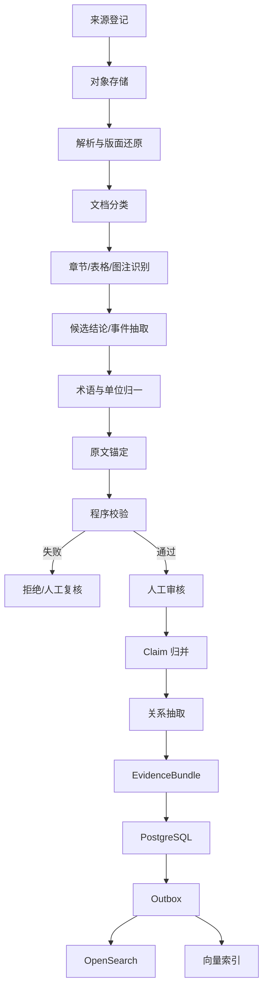

# 知识库与证据工程规范

> 文档版本：V0.2  
> 适用范围：医学文献、临床指南、药品说明书、会议摘要、真实世界研究、患者病历和检查报告。

---

## 1. 总体原则

1. **证据原子化**：一条证据只表达一个主结论。
2. **原文可追溯**：每条证据必须绑定原文 span、页码/章节和 quote hash。
3. **适用性显式化**：明确人群、干预、对照、结局、时间、场景、排除条件。
4. **模型只辅助抽取**：模型不能自由编造证据；最终入库需程序校验和人工审核。
5. **证据与结论分离**：EvidenceUnit 是原始证据，Claim 是规范化结论，EvidenceBundle 是聚合视图。
6. **事实源唯一**：PostgreSQL + 对象存储为事实源，OpenSearch/向量索引可重建。
7. **版本化**：来源、证据、Claim、Bundle、索引、模型和提示词都要有版本。
8. **安全优先**：安全性、剂量、禁忌相关字段必须人工复核。

---

## 2. 来源类型与处理策略

| 来源 | 主要抽取 | 关键字段 |
|---|---|---|
| 临床指南 | 推荐意见、推荐等级、适用人群 | 地区、版本、推荐强度、证据等级 |
| RCT | PICO、效应量、置信区间、随访 | 样本量、随机化、对照、终点 |
| Meta 分析 | 合并效应、异质性、纳入研究 | I²、95% CI、研究数 |
| 真实世界研究 | 队列、暴露、结局、偏倚 | 数据源、混杂控制、随访 |
| 药品说明书 | 适应证、剂量、禁忌、相互作用 | 版本、地区、黑框警告 |
| 会议摘要 | 前沿信息、初步结果 | 会议、年份、是否同行评审 |
| 门诊/出院病历 | 临床事件、诊断、用药、计划 | 时间、否定、确定性、签字 |
| 检验单 | 指标、数值、单位、参考范围 | LOINC、异常标记 |
| 影像报告 | 部位、表现、结论、变化 | 检查时间、对比、BI-RADS 等 |
| 病理报告 | 类型、分级、切缘、标志物 | 标本、免疫组化、分子检测 |
| 基因检测 | 基因、突变、丰度、方法 | HGNC、变异命名、VAF |

**重要边界：**

- 文献/指南 → 证据单元；
- 病历/检查 → 临床事件和患者快照；
- 病历只有在脱敏、伦理审批、队列定义和统计分析后，才可能成为真实世界证据；
- 不要把单个患者的病历直接当作普适医学证据。

---

## 3. 知识生产流水线



### 3.1 来源登记

必须记录：

```text
source_id
source_type
title
authors/organization
publish_date
version
region
license/authorization
retraction_status
object_key
file_hash
ingest_by
ingest_at
```

### 3.2 解析与版面还原

论文/指南：

- 标题、摘要、方法、结果、讨论、结论；
- 表格、图注、脚注、参考文献；
- 多栏排版、页眉页脚、公式。

病历：

- 患者信息、主诉、现病史、既往史、诊断、用药、检验、影像、病理；
- 时间、否定、确定性、待回报状态。

输出统一文档树：

```json
{
  "document_id": "D001",
  "pages": [
    {
      "page_no": 1,
      "blocks": [
        {"type": "section", "text": "Results"},
        {"type": "paragraph", "text": "..."},
        {"type": "table", "caption": "...", "rows": []}
      ]
    }
  ]
}
```

### 3.3 文档分类

建议分类：

```text
guideline
rct
meta_analysis
real_world_study
drug_label
conference_abstract
outpatient_note
discharge_summary
lab_report
imaging_report
pathology_report
genetic_report
```

分类结果影响：

- 抽取 schema；
- 证据等级；
- 审核规则；
- 是否允许进入正式知识库。

---

## 4. 证据原子化规范

### 4.1 原子性判定

一条证据应满足：

- 一个主结论；
- 一个主要人群；
- 一个主要干预；
- 一个主要对照（如有）；
- 一个主要结局；
- 一个明确方向；
- 一个时间点/治疗阶段；
- 一段可定位原文。

如果出现以下情况，应拆分：

- 多个人群/亚组；
- 多个干预或剂量；
- 多个结局；
- 疗效与安全性混合；
- 推荐与证据等级混合；
- 不同治疗线数；
- 不同时间点；
- 条件/例外不同。

### 4.2 不应过度拆分

以下应保持在同一证据单元：

- 同一 PICO 下的效应量、CI、p 值；
- 一个治疗方案的剂量、频次、途径；
- 一条指南推荐及其推荐等级；
- 一个复合终点；
- 结论所必需的限定语。

### 4.3 EvidenceUnit Schema

```json
{
  "evidence_id": "E001",
  "source_id": "S001",
  "source_version": "2025-01",
  "document_type": "rct",
  "quote": "奥希替尼较化疗显著延长 PFS",
  "page_no": 12,
  "section_path": "Results > Efficacy",
  "char_start": 1024,
  "char_end": 1056,
  "quote_hash": "sha256:...",
  "pico": {
    "population": "EGFR突变阳性晚期NSCLC",
    "intervention": "奥希替尼",
    "comparator": "化疗",
    "outcome": "PFS",
    "time": "一线治疗",
    "setting": "晚期"
  },
  "intervention_detail": {
    "dose": "80mg",
    "frequency": "每日一次",
    "route": "口服"
  },
  "effect": {
    "direction": "显著延长",
    "effect_size": "HR 0.46",
    "ci": "95% CI 0.37-0.57",
    "p_value": "<0.001"
  },
  "applicability": [
    "EGFR突变阳性",
    "晚期NSCLC",
    "一线治疗"
  ],
  "exclusions": [],
  "evidence_level": "high",
  "polarity": "positive",
  "certainty": "high",
  "review_status": "approved",
  "extraction_model": "model-v1",
  "extraction_prompt": "prompt-v1",
  "created_at": "2026-01-01T00:00:00Z"
}
```

### 4.4 所有字段都要能服务下游

| 字段 | 下游用途 |
|---|---|
| population | 患者匹配 |
| intervention | 方案生成 |
| comparator | 方案比较 |
| outcome | 疗效/安全评估 |
| dose | 剂量审查 |
| applicability | 适用性过滤 |
| exclusions | 禁忌/排除 |
| evidence_level | 标准/前沿分层 |
| quote/source | 引用与审计 |
| version | 回放 |

---

## 5. Claim 与 EvidenceBundle

### 5.1 Claim

Claim 是规范化后的医学结论。

```json
{
  "claim_id": "C001",
  "canonical_text": "EGFR突变阳性晚期NSCLC患者中，奥希替尼相比化疗改善PFS",
  "pico": {
    "population": "EGFR突变阳性晚期NSCLC",
    "intervention": "奥希替尼",
    "comparator": "化疗",
    "outcome": "PFS",
    "line_of_therapy": "一线"
  },
  "direction": "positive",
  "status": "active",
  "version": 1
}
```

### 5.2 Claim 与 Evidence 的关系

```text
EvidenceUnit 1 ─┐
EvidenceUnit 2 ─┼──→ Claim
EvidenceUnit 3 ─┘
```

关系类型：

```text
supports
refutes
qualifies
updates
context
```

### 5.3 EvidenceBundle

EvidenceBundle 是针对一个 Claim 或一个决策问题的证据集合。

```json
{
  "bundle_id": "B001",
  "claim_id": "C001",
  "bundle_version": 1,
  "scope": "claim",
  "items": [
    {"evidence_id": "E001", "role": "primary"},
    {"evidence_id": "E002", "role": "supporting"},
    {"evidence_id": "E003", "role": "supporting"},
    {"evidence_id": "E004", "role": "contradictory"}
  ],
  "consistency": "mixed",
  "confidence": "medium",
  "summary": "总体支持，但存在一项不一致证据",
  "created_at": "2026-01-01T00:00:00Z"
}
```

**原则：**

- Bundle 不是新证据；
- Bundle 不覆盖单条证据；
- Bundle 保存快照，后续证据更新不改变历史 Bundle；
- 报告必须引用到具体 EvidenceUnit。

---

## 6. 关系抽取

### 6.1 关系类型

| 类型 | 含义 |
|---|---|
| supports | 支持同一结论 |
| refutes | 反驳/结果相反 |
| qualifies | 限定适用条件 |
| updates | 新版本替代旧证据 |
| same_study | 同一研究的不同报告 |
| extends | 扩展人群/随访/结局 |
| contextual | 背景信息 |

### 6.2 同研究去重

必须记录：

```text
study_id
trial_id
parent_study_id
```

同一 RCT 的多个亚组分析不能当作多个独立研究计数。

---

## 7. 患者状态建模

### 7.1 临床事件

```json
{
  "event_id": "EV001",
  "patient_id": "P001",
  "encounter_id": "ENC001",
  "event_type": "lab",
  "event_time": "2026-01-01T09:00:00Z",
  "code": "LOINC:...",
  "name": "肌酐",
  "value": 1.8,
  "unit": "mg/dL",
  "reference_range": "0.6-1.2",
  "negated": false,
  "certainty": "confirmed",
  "status": "final",
  "source_document_id": "D001",
  "source_span": {"page": 2, "char_start": 100, "char_end": 120}
}
```

### 7.2 患者快照

```json
{
  "snapshot_id": "PS001",
  "patient_id": "P001",
  "as_of": "2026-01-01T12:00:00Z",
  "diagnosis": ["非小细胞肺癌"],
  "stage": "IV",
  "pathology": "腺癌",
  "biomarkers": {"EGFR": "pending", "PD-L1": "unknown"},
  "comorbidities": ["间质性肺病"],
  "organ_function": {"creatinine": 1.8, "eGFR": "..."},
  "current_medications": [],
  "allergies": [],
  "treatment_history": [],
  "patient_preferences": [],
  "pending_items": ["基因检测"],
  "signed_by": "doctor_001",
  "version": 1
}
```

### 7.3 时间与不确定性

必须保留：

- `event_time`；
- `recorded_time`；
- `negated`；
- `certainty`；
- `status`；
- `source`；
- `signed_by`。

“未知”“待回报”“阴性”“阳性”必须是不同状态，不能都存成 null。

---

## 8. 质控与审核

### 8.1 自动校验

- schema 校验；
- 必填字段；
- quote 与原文匹配；
- quote_hash 一致；
- 单位合法；
- 术语编码存在；
- 时间逻辑；
- 重复检测；
- 同研究检测；
- 禁忌/剂量字段完整性。

### 8.2 人工审核优先级

P0：

- 禁忌证；
- 剂量；
- 药物相互作用；
- 严重不良反应；
- 关键患者字段；
- 低置信度抽取。

### 8.3 审核状态

```text
draft
machine_extracted
auto_validated
human_reviewed
approved
rejected
deprecated
```

只有 `approved` 可进入正式知识库。

---

## 9. 版本与更新

- 原文件不可变；
- 证据更新生成新版本；
- 旧版本保留；
- 撤稿/指南更新触发影响分析；
- Claim 版本独立；
- Bundle 快照不可变；
- 报告记录证据、规则、模型、提示词版本。

```text
source v1 → source v2
  ↓
evidence E001 v1 → E001 v2
  ↓
claim C001 v1 → C001 v2
  ↓
bundle B001 v1 → B001 v2
  ↓
report R001 snapshot
```

---

## 10. 检索表示

### 10.1 多字段索引

OpenSearch 文档：

```json
{
  "evidence_id": "E001",
  "claim_id": "C001",
  "quote": "...",
  "summary": "...",
  "population": "...",
  "intervention": "...",
  "outcome": "...",
  "evidence_level": "high",
  "source_id": "S001",
  "publish_year": 2025
}
```

### 10.2 向量表示

建议分别对以下对象生成向量：

- EvidenceUnit 的检索文本；
- Claim 的规范化结论文本；
- 必要时对患者问题生成查询向量。

必须记录：

```text
embedding_model
embedding_version
embedding_dim
index_version
```

### 10.3 混合检索

```text
query
→ structured filters
→ BM25 top-k
→ vector top-k
→ RRF / weighted fusion
→ rerank
→ applicability filter
→ evidence bundle
```

---

## 11. 质量指标

| 指标 | 说明 |
|---|---|
| 原文引用准确率 | quote 是否与原文一致 |
| PICO 完整率 | 关键字段是否齐全 |
| 适用条件准确率 | 人群/排除条件是否正确 |
| 证据等级一致率 | 与专家标注是否一致 |
| 重复证据率 | 同一研究重复入库比例 |
| 专家复核通过率 | 人工审核通过比例 |
| 检索 Recall@K | 正确证据是否召回 |
| 引用忠实度 | 报告结论是否有证据支持 |
| 严重安全违规率 | 禁忌/剂量错误比例 |

---

## 12. 常见错误

1. 按固定 token 切分医学结论；
2. 把整篇文献作为一个证据；
3. 把多个结论塞进一个证据单元；
4. 丢掉适用条件和排除条件；
5. 模型总结后直接入库；
6. 把同一研究的多个报告当独立证据；
7. 把病历直接当普适证据；
8. 只存向量不存原文；
9. 证据更新覆盖旧版本；
10. 报告引用只到文档级，不到原文 span。

---

## 13. 评审修订补充（V0.2）

### 13.1 抽取必填字段与拒绝规则

以下字段缺失时，候选证据直接标记为 `rejected`，不得进入人工审核队列：

- `quote` 为空或无法在原文定位；
- `population` 为空；
- `intervention` 为空（纯诊断/预后类证据除外）；
- `outcome` 为空；
- `direction` 为空；
- `evidence_type` 为空。

以下情况进入人工复核：

- 剂量缺失但结论涉及剂量；
- 适用条件缺失；
- 证据等级无法判断；
- 原文跨表格或跨段落。

### 13.2 版权状态行为矩阵

| license_status | 允许存储 | 允许展示 | 允许下载 |
|---|---|---|---|
| open | 原文 + 证据 | 原文/片段 | 按授权 |
| internal | 原文 + 证据 | 内部原文/片段 | 禁止外传 |
| restricted | 元数据 + quote 片段 | 仅片段 | 禁止完整原文 |
| unknown | 元数据 | 仅引用信息 | 禁止 |

`restricted` 或 `unknown` 的来源，文件访问接口不得返回完整原文。

### 13.3 Claim 归并规则

以下条件同时满足时，可归并到同一个 Claim：

- 同一疾病和人群；
- 同一治疗线数；
- 同一干预和对照；
- 同一结局；
- 同一方向；
- PICO 关键限定条件一致。

以下情况必须新建 Claim：

- 人群亚组不同；
- 结局不同；
- 治疗线数不同；
- 干预剂量或顺序不同；
- 结论方向不同。

冲突证据归入同一 Claim 的不同关系，不得强行合并为一致结论。

### 13.4 否定语义处理

在做患者与证据匹配前，必须先处理 `negated`：

- `negated=true` 的事件表示该事实不存在；
- 不能匹配以该事实为纳入条件的证据；
- 报告和检索结果必须显示否定上下文；
- 不得把否认间质性肺病当成合并间质性肺病。

### 13.5 pending_items 阻断规则

`pending_items` 分为：

| 级别 | 说明 | 系统行为 |
|---|---|---|
| blocking | 直接改变治疗选择或安全判断 | 禁止输出确定性最终方案 |
| important | 影响方案排序 | 输出条件性方案并高亮 |
| non_blocking | 不影响当前决策 | 正常输出 |

具体哪些检查属于 blocking，由临床负责人配置并版本化。

### 13.6 撤稿与失效处理

文献撤稿或指南被替代时：

1. 更新 `source_document.retraction_status`；
2. 找出所有关联 `evidence_unit`；
3. 将证据标记为 `deprecated`；
4. 重新生成受影响的 Claim/Bundle 版本；
5. 历史报告保留原样，但增加撤稿警示；
6. 新决策不得再使用撤稿证据；
7. 生成影响分析报告。

### 13.7 术语与本体

至少明确以下编码体系：

- 疾病：ICD-10 / SNOMED CT；
- 检验：LOINC；
- 药物：RxNorm / ATC；
- 基因：HGNC；
- 不良反应：MedDRA；
- 手术：ICD-9-CM-3 或本地编码。

没有标准编码时，保留原文并标记为未标准化，不得静默丢弃。

### 13.8 证据冲突检测

生成 EvidenceBundle 时必须检测：

- 支持与反驳；
- 不同人群；
- 不同剂量；
- 不同结局；
- 新旧指南差异；
- 同一研究重复报告。

冲突证据必须在 Bundle 中保留，并在报告中展示。

### 13.9 弃用级联规则

- 证据 `deprecated` 后，旧 Bundle 和旧报告不变；
- 新 Bundle 生成新版本；
- 新决策排除 deprecated 证据；
- `report_citation` 保留历史引用；
- 需要时在历史报告上增加失效提示。


