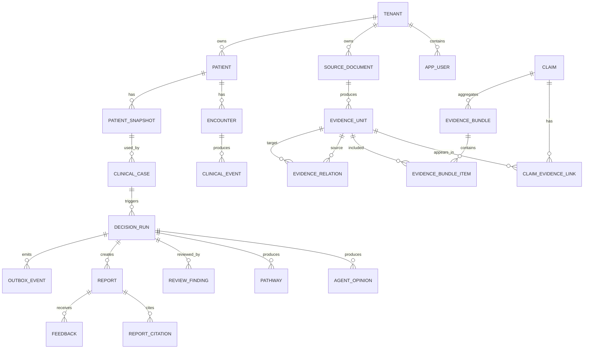

# 数据模型与数据库设计

> 文档版本：V0.2  
> 主数据库：PostgreSQL 16  
> 检索：OpenSearch + pgvector / Milvus  
> 对象存储：MinIO / S3

---

## 1. 设计原则

1. PostgreSQL 是结构化事实源；
2. 原始文件存对象存储；
3. OpenSearch/向量库是派生索引；
4. 证据和版本不可被覆盖；
5. 所有核心表有稳定 ID、租户 ID、时间戳；
6. 高频繁过滤字段单独建列；
7. 关系用关系表表达；
8. 审计表只追加；
9. 报告保存快照；
10. 多租户隔离。

---

## 2. ER 图

> 兼容性说明：下面使用标准 Mermaid `erDiagram` 语法，实体名全部使用英文，避免部分 Markdown 渲染器把中文、SQL 关键字或特殊基数符号解析成乱码。若你的编辑器不支持 Mermaid，可直接看后面的 ASCII 关系图。

### 2.1 Mermaid ER 图



### 2.2 ASCII 关系图

```text
TENANT
  ├── APP_USER
  ├── SOURCE_DOCUMENT
  │     └── EVIDENCE_UNIT
  │           ├── CLAIM_EVIDENCE_LINK ── CLAIM
  │           ├── EVIDENCE_BUNDLE_ITEM ── EVIDENCE_BUNDLE ── CLAIM
  │           └── EVIDENCE_RELATION
  └── PATIENT
        ├── ENCOUNTER
        │     └── CLINICAL_EVENT
        └── PATIENT_SNAPSHOT
              └── CLINICAL_CASE
                    └── DECISION_RUN
                          ├── AGENT_OPINION
                          ├── PATHWAY
                          ├── REVIEW_FINDING
                          ├── REPORT
                          │     ├── REPORT_CITATION
                          │     └── FEEDBACK
                          └── OUTBOX_EVENT
```

---

## 3. 核心表 DDL

### 3.1 租户与用户

```sql
CREATE TABLE tenant (
    tenant_id       UUID PRIMARY KEY,
    name            TEXT NOT NULL,
    status          TEXT NOT NULL DEFAULT 'active',
    created_at      TIMESTAMPTZ NOT NULL DEFAULT now()
);

CREATE TABLE app_user (
    user_id         UUID PRIMARY KEY,
    tenant_id       UUID NOT NULL REFERENCES tenant(tenant_id),
    username        TEXT NOT NULL,
    display_name    TEXT NOT NULL,
    password_hash   TEXT NOT NULL,
    roles           JSONB NOT NULL DEFAULT '[]',
    status          TEXT NOT NULL DEFAULT 'active',
    created_at      TIMESTAMPTZ NOT NULL DEFAULT now(),
    UNIQUE (tenant_id, username)
);
```

### 3.2 来源文档

```sql
CREATE TABLE source_document (
    source_id       UUID PRIMARY KEY,
    tenant_id       UUID NOT NULL REFERENCES tenant(tenant_id),
    title           TEXT NOT NULL,
    source_type     TEXT NOT NULL,
    authors         JSONB,
    publish_date    DATE,
    version         TEXT,
    region          TEXT,
    license_status  TEXT,
    retraction_status TEXT DEFAULT 'none',
    object_key      TEXT NOT NULL,
    file_hash       TEXT NOT NULL,
    mime_type       TEXT,
    status          TEXT NOT NULL DEFAULT 'registered',
    created_by      UUID,
    created_at      TIMESTAMPTZ NOT NULL DEFAULT now(),
    updated_at      TIMESTAMPTZ NOT NULL DEFAULT now()
);

CREATE INDEX idx_source_document_tenant_type
    ON source_document (tenant_id, source_type, publish_date DESC);

CREATE INDEX idx_source_document_hash
    ON source_document (file_hash);
```

### 3.3 证据单元

```sql
CREATE TABLE evidence_unit (
    evidence_id       UUID PRIMARY KEY,
    tenant_id         UUID NOT NULL REFERENCES tenant(tenant_id),
    source_id         UUID NOT NULL REFERENCES source_document(source_id),
    primary_claim_id  UUID,
    evidence_type     TEXT NOT NULL,
    quote             TEXT NOT NULL,
    quote_hash        TEXT NOT NULL,
    page_no           INT,
    section_path      TEXT,
    char_start        INT,
    char_end          INT,
    pico              JSONB NOT NULL,
    intervention_detail JSONB,
    effect            JSONB,
    applicability     JSONB,
    exclusions        JSONB,
    evidence_level    TEXT,
    polarity          TEXT,
    certainty         TEXT,
    status            TEXT NOT NULL DEFAULT 'draft',
    version           INT NOT NULL DEFAULT 1,
    supersedes_id     UUID REFERENCES evidence_unit(evidence_id),
    reviewed_by       UUID,
    reviewed_at       TIMESTAMPTZ,
    extraction_model  TEXT,
    extraction_prompt TEXT,
    created_at        TIMESTAMPTZ NOT NULL DEFAULT now(),
    updated_at        TIMESTAMPTZ NOT NULL DEFAULT now()
);

CREATE INDEX idx_evidence_tenant_status
    ON evidence_unit (tenant_id, status, evidence_type);

CREATE INDEX idx_evidence_source
    ON evidence_unit (source_id);

CREATE INDEX idx_evidence_pico_gin
    ON evidence_unit USING GIN (pico);

CREATE INDEX idx_evidence_applicability_gin
    ON evidence_unit USING GIN (applicability);
```

### 3.4 Claim

```sql
CREATE TABLE claim (
    claim_id         UUID PRIMARY KEY,
    tenant_id        UUID NOT NULL REFERENCES tenant(tenant_id),
    canonical_text   TEXT NOT NULL,
    pico_key         TEXT NOT NULL,
    pico             JSONB NOT NULL,
    outcome          TEXT,
    direction        TEXT,
    status           TEXT NOT NULL DEFAULT 'active',
    version          INT NOT NULL DEFAULT 1,
    created_at       TIMESTAMPTZ NOT NULL DEFAULT now(),
    updated_at       TIMESTAMPTZ NOT NULL DEFAULT now()
);

CREATE UNIQUE INDEX uq_claim_pico_key
    ON claim (tenant_id, pico_key);
```

### 3.5 证据与结论关系

```sql
CREATE TABLE claim_evidence_link (
    claim_id      UUID NOT NULL REFERENCES claim(claim_id),
    evidence_id   UUID NOT NULL REFERENCES evidence_unit(evidence_id),
    relation      TEXT NOT NULL,
    is_primary    BOOLEAN NOT NULL DEFAULT false,
    weight        NUMERIC(5,4),
    reason        TEXT,
    created_at    TIMESTAMPTZ NOT NULL DEFAULT now(),
    PRIMARY KEY (claim_id, evidence_id)
);

CREATE INDEX idx_claim_evidence_evidence
    ON claim_evidence_link (evidence_id);

CREATE INDEX idx_claim_evidence_relation
    ON claim_evidence_link (claim_id, relation);
```

### 3.6 证据包

```sql
CREATE TABLE evidence_bundle (
    bundle_id       UUID PRIMARY KEY,
    tenant_id       UUID NOT NULL REFERENCES tenant(tenant_id),
    claim_id        UUID NOT NULL REFERENCES claim(claim_id),
    bundle_version  INT NOT NULL,
    scope           TEXT NOT NULL DEFAULT 'claim',
    consistency     TEXT,
    confidence      TEXT,
    summary         TEXT,
    status          TEXT NOT NULL DEFAULT 'active',
    created_at      TIMESTAMPTZ NOT NULL DEFAULT now(),
    UNIQUE (claim_id, bundle_version)
);

CREATE TABLE evidence_bundle_item (
    bundle_id      UUID NOT NULL REFERENCES evidence_bundle(bundle_id),
    evidence_id    UUID NOT NULL REFERENCES evidence_unit(evidence_id),
    role           TEXT NOT NULL,
    position       INT,
    note           TEXT,
    PRIMARY KEY (bundle_id, evidence_id)
);
```

### 3.7 证据关系

```sql
CREATE TABLE evidence_relation (
    from_evidence_id UUID NOT NULL REFERENCES evidence_unit(evidence_id),
    to_evidence_id   UUID NOT NULL REFERENCES evidence_unit(evidence_id),
    relation_type    TEXT NOT NULL,
    confidence       NUMERIC(5,4),
    note             TEXT,
    created_at       TIMESTAMPTZ NOT NULL DEFAULT now(),
    PRIMARY KEY (from_evidence_id, to_evidence_id, relation_type)
);
```

### 3.8 患者与事件

```sql
CREATE TABLE patient (
    patient_id      UUID PRIMARY KEY,
    tenant_id       UUID NOT NULL REFERENCES tenant(tenant_id),
    pseudonym       TEXT NOT NULL,
    birth_year      INT,
    sex             TEXT,
    status          TEXT NOT NULL DEFAULT 'active',
    created_at      TIMESTAMPTZ NOT NULL DEFAULT now(),
    UNIQUE (tenant_id, pseudonym)
);

CREATE TABLE encounter (
    encounter_id    UUID PRIMARY KEY,
    tenant_id       UUID NOT NULL REFERENCES tenant(tenant_id),
    patient_id      UUID NOT NULL REFERENCES patient(patient_id),
    encounter_type  TEXT NOT NULL,
    started_at      TIMESTAMPTZ,
    ended_at        TIMESTAMPTZ,
    department      TEXT,
    source_system   TEXT
);

CREATE TABLE clinical_event (
    event_id         UUID PRIMARY KEY,
    tenant_id        UUID NOT NULL REFERENCES tenant(tenant_id),
    patient_id       UUID NOT NULL REFERENCES patient(patient_id),
    encounter_id     UUID REFERENCES encounter(encounter_id),
    event_type       TEXT NOT NULL,
    event_time       TIMESTAMPTZ,
    recorded_time    TIMESTAMPTZ,
    code_system      TEXT,
    code             TEXT,
    name             TEXT,
    value_json       JSONB,
    unit             TEXT,
    negated          BOOLEAN DEFAULT false,
    certainty        TEXT,
    status           TEXT,
    source_document_id UUID REFERENCES source_document(source_id),
    source_span      JSONB,
    created_at       TIMESTAMPTZ NOT NULL DEFAULT now()
);

CREATE INDEX idx_clinical_event_patient_time
    ON clinical_event (tenant_id, patient_id, event_time DESC);
```

### 3.9 患者快照与病例

```sql
CREATE TABLE patient_snapshot (
    snapshot_id      UUID PRIMARY KEY,
    tenant_id        UUID NOT NULL REFERENCES tenant(tenant_id),
    patient_id       UUID NOT NULL REFERENCES patient(patient_id),
    as_of            TIMESTAMPTZ NOT NULL,
    state_json       JSONB NOT NULL,
    missing_items    JSONB,
    version          INT NOT NULL DEFAULT 1,
    signed_by        UUID REFERENCES app_user(user_id),
    signed_at        TIMESTAMPTZ,
    created_at       TIMESTAMPTZ NOT NULL DEFAULT now()
);

CREATE TABLE clinical_case (
    case_id          UUID PRIMARY KEY,
    tenant_id        UUID NOT NULL REFERENCES tenant(tenant_id),
    patient_id       UUID NOT NULL REFERENCES patient(patient_id),
    snapshot_id      UUID REFERENCES patient_snapshot(snapshot_id),
    name             TEXT,
    disease          TEXT,
    status           TEXT NOT NULL DEFAULT 'draft',
    created_by       UUID REFERENCES app_user(user_id),
    created_at       TIMESTAMPTZ NOT NULL DEFAULT now()
);
```

### 3.10 决策运行、Agent 意见、路径、审查

```sql
CREATE TABLE decision_run (
    decision_id      UUID PRIMARY KEY,
    tenant_id        UUID NOT NULL REFERENCES tenant(tenant_id),
    case_id          UUID NOT NULL REFERENCES clinical_case(case_id),
    snapshot_id      UUID NOT NULL REFERENCES patient_snapshot(snapshot_id),
    question         TEXT NOT NULL,
    status           TEXT NOT NULL DEFAULT 'queued',
    stage            TEXT,
    error_code       TEXT,
    started_at       TIMESTAMPTZ,
    finished_at      TIMESTAMPTZ,
    created_by       UUID REFERENCES app_user(user_id),
    created_at       TIMESTAMPTZ NOT NULL DEFAULT now()
);

CREATE TABLE agent_opinion (
    opinion_id       UUID PRIMARY KEY,
    decision_id      UUID NOT NULL REFERENCES decision_run(decision_id),
    specialty        TEXT NOT NULL,
    recommendation   TEXT,
    payload_json     JSONB NOT NULL,
    confidence       TEXT,
    model_version    TEXT,
    prompt_version   TEXT,
    created_at       TIMESTAMPTZ NOT NULL DEFAULT now()
);

CREATE TABLE pathway (
    pathway_id       UUID PRIMARY KEY,
    decision_id      UUID NOT NULL REFERENCES decision_run(decision_id),
    pathway_type     TEXT NOT NULL,
    title            TEXT NOT NULL,
    content_json     JSONB NOT NULL,
    status           TEXT NOT NULL,
    created_at       TIMESTAMPTZ NOT NULL DEFAULT now()
);

CREATE TABLE review_finding (
    finding_id       UUID PRIMARY KEY,
    decision_id      UUID NOT NULL REFERENCES decision_run(decision_id),
    pathway_id       UUID REFERENCES pathway(pathway_id),
    dimension        TEXT NOT NULL,
    severity         TEXT NOT NULL,
    rule_id          TEXT,
    evidence_id      UUID,
    problem          TEXT NOT NULL,
    suggested_fix    TEXT,
    status           TEXT NOT NULL,
    created_at       TIMESTAMPTZ NOT NULL DEFAULT now()
);
```

### 3.11 报告与引用

```sql
CREATE TABLE report (
    report_id        UUID PRIMARY KEY,
    tenant_id        UUID NOT NULL REFERENCES tenant(tenant_id),
    decision_id      UUID NOT NULL REFERENCES decision_run(decision_id),
    status           TEXT NOT NULL DEFAULT 'draft',
    content_json     JSONB NOT NULL,
    content_markdown TEXT,
    evidence_bundle_ids UUID[],
    model_version    TEXT,
    prompt_version   TEXT,
    rule_version     TEXT,
    signed_by        UUID REFERENCES app_user(user_id),
    signed_at        TIMESTAMPTZ,
    created_at       TIMESTAMPTZ NOT NULL DEFAULT now()
);

CREATE TABLE report_citation (
    citation_id      UUID PRIMARY KEY,
    report_id        UUID NOT NULL REFERENCES report(report_id),
    section_key      TEXT,
    evidence_id      UUID NOT NULL REFERENCES evidence_unit(evidence_id),
    claim_id         UUID REFERENCES claim(claim_id),
    quote            TEXT,
    source_id        UUID REFERENCES source_document(source_id),
    page_no          INT,
    created_at       TIMESTAMPTZ NOT NULL DEFAULT now()
);
```

### 3.12 反馈、审计、Outbox

```sql
CREATE TABLE feedback (
    feedback_id      UUID PRIMARY KEY,
    tenant_id        UUID NOT NULL REFERENCES tenant(tenant_id),
    report_id        UUID NOT NULL REFERENCES report(report_id),
    user_id          UUID REFERENCES app_user(user_id),
    rating           INT,
    adopted          BOOLEAN,
    modified_sections JSONB,
    reason           TEXT,
    outcome_json     JSONB,
    created_at       TIMESTAMPTZ NOT NULL DEFAULT now()
);

CREATE TABLE audit_log (
    audit_id         BIGSERIAL PRIMARY KEY,
    tenant_id        UUID,
    user_id          UUID,
    action           TEXT NOT NULL,
    resource_type    TEXT,
    resource_id      TEXT,
    trace_id         TEXT,
    detail_json      JSONB,
    created_at       TIMESTAMPTZ NOT NULL DEFAULT now()
);

CREATE TABLE outbox_event (
    event_id         UUID PRIMARY KEY,
    aggregate_type   TEXT NOT NULL,
    aggregate_id     TEXT NOT NULL,
    event_type       TEXT NOT NULL,
    payload_json     JSONB NOT NULL,
    status           TEXT NOT NULL DEFAULT 'pending',
    retry_count      INT NOT NULL DEFAULT 0,
    available_at     TIMESTAMPTZ NOT NULL DEFAULT now(),
    created_at       TIMESTAMPTZ NOT NULL DEFAULT now()
);

CREATE INDEX idx_outbox_pending
    ON outbox_event (status, available_at);
```

---

## 4. 表与字段说明

> 本节对第 3 节 DDL 中的表逐张说明。正式迁移脚本中建议同步使用 PostgreSQL `COMMENT ON TABLE` 和 `COMMENT ON COLUMN`，让数据库本身也具备自描述能力。

### 4.0 公共字段约定

| 字段 | 备注 |
|---|---|
| `tenant_id` | 租户/机构 ID，用于数据隔离。所有涉及机构数据的表都应带此字段。 |
| `created_at` | 记录创建时间。 |
| `updated_at` | 记录最后更新时间。 |
| `status` | 业务状态，具体枚举由各表定义。 |
| `version` | 版本号。医学证据、结论、快照和报告都应支持版本化。 |
| `signed_by` | 最终确认/签字的医生或用户 ID。 |
| `source_id` | 原始文档 ID，用于回到原文。 |
| `evidence_id` | 证据原子单元 ID。 |
| `claim_id` | 规范化医学结论 ID。 |

---

### 4.1 `tenant`：租户/机构表

| 字段 | 备注 |
|---|---|
| `tenant_id` | 租户唯一标识。可对应一家医院、院区、医疗集团或科研机构。 |
| `tenant_type` | 租户类型：`system` 平台公共知识库、`hospital` 医院业务租户。 |
| `name` | 租户名称。 |
| `status` | 租户状态：`active` 正常、`disabled` 停用。 |
| `created_at` | 租户创建时间。 |

### 4.2 `app_user`：系统用户表

| 字段 | 备注 |
|---|---|
| `user_id` | 用户唯一标识。 |
| `tenant_id` | 用户所属租户。当前设计为一个用户属于一个租户。 |
| `username` | 登录名，在租户内唯一。 |
| `display_name` | 页面展示名称，如“张医生”。 |
| `password_hash` | 密码哈希，禁止存储明文密码。 |
| `roles` | 用户角色数组，如 `doctor`、`pharmacist`、`admin`。 |
| `status` | 用户状态：`active`、`disabled`、`locked`。 |
| `created_at` | 用户创建时间。 |

### 4.3 `source_document`：原始文档表

| 字段 | 备注 |
|---|---|
| `source_id` | 原始文档唯一标识。 |
| `tenant_id` | 文档所属租户。 |
| `title` | 文档标题。 |
| `source_type` | 来源类型：`guideline`、`rct`、`meta_analysis`、`drug_label`、`patient_note` 等。 |
| `authors` | 作者或发布机构，JSON 数组。 |
| `publish_date` | 发表/发布日期。 |
| `version` | 文档版本，如指南年份、说明书版本。 |
| `region` | 适用地区，如 CN、US、EU。 |
| `license_status` | 版权/授权状态，用于判断能否存储和展示原文。 |
| `retraction_status` | 撤稿/失效状态：`none`、`retracted`、`superseded`。 |
| `object_key` | 对象存储中的文件路径。 |
| `file_hash` | 文件内容哈希，用于去重和完整性校验。 |
| `mime_type` | 文件类型，如 `application/pdf`。 |
| `status` | 文档处理状态：`registered`、`parsing`、`review_pending`、`approved`、`failed`。 |
| `created_by` | 上传/登记用户 ID。 |
| `created_at` | 记录创建时间。 |
| `updated_at` | 记录最后更新时间。 |

### 4.4 `evidence_unit`：证据原子单元表

| 字段 | 备注 |
|---|---|
| `evidence_id` | 证据唯一标识。 |
| `tenant_id` | 证据所属租户。 |
| `source_id` | 来源文档 ID。 |
| `primary_claim_id` | 该证据的主要结论 ID；建议通过后续外键或关系表约束。 |
| `evidence_type` | 证据类型：`efficacy`、`safety`、`dose`、`diagnostic`、`prognostic` 等。 |
| `quote` | 原文引用，必须来自来源文档，不允许模型自由编造。 |
| `quote_hash` | 原文引用哈希，用于检测原文变化和校验一致性。 |
| `page_no` | 原文页码。 |
| `section_path` | 章节路径，如 `Results > Efficacy`。 |
| `char_start` | 原文引用起始字符位置。 |
| `char_end` | 原文引用结束字符位置。 |
| `pico` | 结构化 PICO/PICOTS 信息，JSONB。 |
| `intervention_detail` | 干预细节，如剂量、频次、途径，JSONB。 |
| `effect` | 效应量、置信区间、p 值等，JSONB。 |
| `applicability` | 适用条件，JSONB。 |
| `exclusions` | 排除条件/禁忌条件，JSONB。 |
| `evidence_level` | 证据等级，如 high、medium、low。 |
| `polarity` | 结论方向：`positive`、`negative`、`neutral`。 |
| `certainty` | 确定性：`high`、`medium`、`low`、`unknown`。 |
| `status` | 审核状态：`draft`、`auto_validated`、`human_reviewed`、`approved`、`rejected`、`deprecated`。 |
| `version` | 证据版本号。 |
| `supersedes_id` | 被当前版本替代的旧证据 ID。 |
| `reviewed_by` | 审核人用户 ID。 |
| `reviewed_at` | 审核时间。 |
| `extraction_model` | 抽取使用的模型版本。 |
| `extraction_prompt` | 抽取使用的提示词版本。 |
| `created_at` | 记录创建时间。 |
| `updated_at` | 记录最后更新时间。 |

---

### 4.5 `claim`：规范化结论表

| 字段 | 备注 |
|---|---|
| `claim_id` | 结论唯一标识。 |
| `tenant_id` | 结论所属租户。 |
| `canonical_text` | 规范化后的结论文本。 |
| `pico_key` | 规范化 PICO 的哈希键，用于结论去重。 |
| `pico` | 结论对应的结构化 PICO，JSONB。 |
| `outcome` | 主要结局，如 PFS、OS、ORR、不良反应。 |
| `direction` | 结论方向：`positive`、`negative`、`neutral`。 |
| `status` | 结论状态：`active`、`deprecated`、`merged`。 |
| `version` | 结论版本号。 |
| `created_at` | 记录创建时间。 |
| `updated_at` | 记录最后更新时间。 |

### 4.6 `claim_evidence_link`：证据与结论关联表

| 字段 | 备注 |
|---|---|
| `claim_id` | 关联的结论 ID。 |
| `evidence_id` | 关联的证据 ID。 |
| `relation` | 证据对结论的关系：`supports`、`refutes`、`qualifies`、`updates`、`context`。 |
| `is_primary` | 是否为该证据的主要关联结论。 |
| `weight` | 关联权重，用于聚合排序，不能替代临床判断。 |
| `reason` | 关联理由，建议记录证据等级、人群匹配等说明。 |
| `created_at` | 关联创建时间。 |

### 4.7 `evidence_bundle`：证据包表

| 字段 | 备注 |
|---|---|
| `bundle_id` | 证据包唯一标识。 |
| `tenant_id` | 证据包所属租户。 |
| `claim_id` | 证据包对应的结论 ID。 |
| `bundle_version` | 证据包版本号。 |
| `scope` | 证据包范围：`claim`、`decision_question`、`patient`。 |
| `consistency` | 证据一致性：`consistent`、`mixed`、`conflicting`、`insufficient`。 |
| `confidence` | 综合置信度：`high`、`medium`、`low`。 |
| `summary` | 证据包摘要，供检索和报告使用。 |
| `status` | 证据包状态：`active`、`superseded`、`archived`。 |
| `created_at` | 证据包创建时间。 |

### 4.8 `evidence_bundle_item`：证据包明细表

| 字段 | 备注 |
|---|---|
| `bundle_id` | 所属证据包 ID。 |
| `evidence_id` | 证据 ID。 |
| `role` | 该证据在包中的角色：`primary`、`supporting`、`contradictory`、`contextual`。 |
| `position` | 展示顺序。 |
| `note` | 该证据纳入本包的理由或备注。 |

### 4.9 `evidence_relation`：证据之间的关系表

| 字段 | 备注 |
|---|---|
| `from_evidence_id` | 关系起始证据 ID。 |
| `to_evidence_id` | 关系目标证据 ID。 |
| `relation_type` | 关系类型：`same_study`、`contradicts`、`updates`、`extends`、`same_population`。 |
| `confidence` | 关系置信度。 |
| `note` | 关系说明。 |
| `created_at` | 关系创建时间。 |

---

### 4.10 `patient`：患者主表

| 字段 | 备注 |
|---|---|
| `patient_id` | 患者唯一标识。 |
| `tenant_id` | 患者所属租户/医院。 |
| `pseudonym` | 患者假名/研究编号，减少直接标识信息暴露。 |
| `birth_year` | 出生年份，用于年龄相关规则；避免存完整生日时可使用。 |
| `sex` | 生理性别。 |
| `status` | 患者状态：`active`、`deceased`、`inactive`。 |
| `created_at` | 记录创建时间。 |

### 4.11 `encounter`：就诊表

| 字段 | 备注 |
|---|---|
| `encounter_id` | 就诊唯一标识。 |
| `tenant_id` | 所属租户。 |
| `patient_id` | 患者 ID。 |
| `encounter_type` | 就诊类型：门诊、住院、急诊、MDT 等。 |
| `started_at` | 就诊开始时间。 |
| `ended_at` | 就诊结束时间。 |
| `department` | 科室。 |
| `source_system` | 来源系统，如 HIS、EMR、LIS。 |

### 4.12 `clinical_event`：临床事件表

| 字段 | 备注 |
|---|---|
| `event_id` | 临床事件唯一标识。 |
| `tenant_id` | 所属租户。 |
| `patient_id` | 患者 ID。 |
| `encounter_id` | 所属就诊 ID，可为空。 |
| `event_type` | 事件类型：诊断、检验、影像、病理、用药、手术、基因检测等。 |
| `event_time` | 临床事件发生时间。 |
| `recorded_time` | 数据录入/报告时间。 |
| `code_system` | 编码体系，如 ICD-10、LOINC、SNOMED、RxNorm。 |
| `code` | 标准编码。 |
| `name` | 事件名称/指标名称。 |
| `value_json` | 结构化值，如数值、文本、结构化报告。 |
| `unit` | 单位。 |
| `negated` | 是否否定，如“否认胸痛”应为 true。 |
| `certainty` | 确定性：`confirmed`、`suspected`、`pending`、`ruled_out`。 |
| `status` | 数据状态：`preliminary`、`final`、`corrected`。 |
| `source_document_id` | 来源文档 ID。 |
| `source_span` | 原文定位信息，JSONB，如页码、字符位置、bbox。 |
| `created_at` | 记录创建时间。 |

### 4.13 `patient_snapshot`：患者状态快照表

| 字段 | 备注 |
|---|---|
| `snapshot_id` | 快照唯一标识。 |
| `tenant_id` | 所属租户。 |
| `patient_id` | 患者 ID。 |
| `as_of` | 该快照对应的数据截止时间。 |
| `state_json` | 患者状态结构化内容，如诊断、分期、基因、合并症、用药、检验。 |
| `missing_items` | 关键缺失信息/待回报项。 |
| `version` | 快照版本号。 |
| `signed_by` | 确认快照的医生用户 ID。 |
| `signed_at` | 医生确认时间。 |
| `created_at` | 记录创建时间。 |

### 4.14 `clinical_case`：临床病例表

| 字段 | 备注 |
|---|---|
| `case_id` | 病例唯一标识。 |
| `tenant_id` | 所属租户。 |
| `patient_id` | 患者 ID。 |
| `snapshot_id` | 当前使用的患者快照 ID。 |
| `name` | 病例名称。 |
| `disease` | 主要疾病/病种。 |
| `status` | 病例状态：`draft`、`active`、`closed`、`archived`。 |
| `created_by` | 创建人用户 ID。 |
| `created_at` | 病例创建时间。 |

---

### 4.15 `decision_run`：决策运行表

| 字段 | 备注 |
|---|---|
| `decision_id` | 一次决策运行唯一标识。 |
| `tenant_id` | 所属租户。 |
| `case_id` | 关联病例 ID。 |
| `snapshot_id` | 本次决策使用的患者快照 ID。 |
| `question` | 本次决策问题。 |
| `status` | 状态：`queued`、`retrieving`、`reasoning`、`reviewing`、`completed`、`failed`。 |
| `stage` | 当前执行阶段。 |
| `error_code` | 失败错误码。 |
| `started_at` | 开始时间。 |
| `finished_at` | 完成时间。 |
| `created_by` | 发起人用户 ID。 |
| `created_at` | 记录创建时间。 |

### 4.16 `agent_opinion`：多专科 Agent 意见表

| 字段 | 备注 |
|---|---|
| `opinion_id` | Agent 意见唯一标识。 |
| `decision_id` | 所属决策运行 ID。 |
| `specialty` | 专科角色，如 `medical_oncology`、`respiratory`、`pharmacy`。 |
| `recommendation` | 该专科的主要建议。 |
| `payload_json` | 完整结构化意见，包括支持/反对证据、假设、缺失信息、风险。 |
| `confidence` | 该意见置信度。 |
| `model_version` | 使用的模型版本。 |
| `prompt_version` | 使用的提示词版本。 |
| `created_at` | 创建时间。 |

### 4.17 `pathway`：候选路径表

| 字段 | 备注 |
|---|---|
| `pathway_id` | 路径唯一标识。 |
| `decision_id` | 所属决策运行 ID。 |
| `pathway_type` | 路径类型：`standard`、`frontier`、`validation`。 |
| `title` | 路径标题。 |
| `content_json` | 路径结构化内容，包括措施、顺序、证据、风险、触发条件。 |
| `status` | 路径状态：`candidate`、`retained`、`repaired`、`rejected`。 |
| `created_at` | 创建时间。 |

### 4.18 `review_finding`：审查发现表

| 字段 | 备注 |
|---|---|
| `finding_id` | 审查发现唯一标识。 |
| `decision_id` | 所属决策运行 ID。 |
| `pathway_id` | 关联路径 ID，可为空。 |
| `dimension` | 审查维度：`safety`、`tail_risk`、`evidence_dose`、`sequence`、`marginal_value`。 |
| `severity` | 严重程度：`info`、`warning`、`critical`。 |
| `rule_id` | 命中的规则 ID。 |
| `evidence_id` | 相关证据 ID。 |
| caused_by_agent_opinion_id | 触发该审查发现的 Agent 意见 ID，用于定位来源。 |
| `problem` | 发现的问题。 |
| `suggested_fix` | 建议修复方式。 |
| `status` | 处理状态：`open`、`repaired`、`accepted`、`rejected`。 |
| `created_at` | 创建时间。 |

---

### 4.19 `report`：决策报告表

| 字段 | 备注 |
|---|---|
| `report_id` | 报告唯一标识。 |
| `tenant_id` | 所属租户。 |
| `decision_id` | 关联决策运行 ID。 |
| `status` | 报告状态：`draft`、`reviewed`、`signed`、`rejected`、`archived`。 |
| `content_json` | 结构化报告内容。 |
| `content_markdown` | 可读的 Markdown 版本。 |
| `evidence_bundle_ids` | 本报告使用的证据包 ID 数组。 |
| `model_version` | 生成报告使用的模型版本。 |
| `prompt_version` | 使用的提示词版本。 |
| `rule_version` | 使用的规则版本。 |
| `signed_by` | 签字医生用户 ID。 |
| `signed_at` | 签字时间。 |
| `created_at` | 创建时间。 |

### 4.20 `report_citation`：报告引用表

| 字段 | 备注 |
|---|---|
| `citation_id` | 引用唯一标识。 |
| `report_id` | 所属报告 ID。 |
| `section_key` | 引用所在的报告章节。 |
| `evidence_id` | 被引用的证据 ID。 |
| `claim_id` | 被引用的结论 ID，可为空。 |
| `quote` | 报告展示的原文引用。 |
| `source_id` | 来源文档 ID。 |
| `page_no` | 原文页码。 |
| `created_at` | 创建时间。 |

---

### 4.21 `feedback`：反馈与结局表

| 字段 | 备注 |
|---|---|
| `feedback_id` | 反馈唯一标识。 |
| `tenant_id` | 所属租户。 |
| `report_id` | 被反馈的报告 ID。 |
| `user_id` | 反馈用户 ID。 |
| `rating` | 评分。 |
| `adopted` | 医生是否采纳报告建议。 |
| `modified_sections` | 医生修改了哪些章节。 |
| `reason` | 修改/不采纳原因。 |
| `outcome_json` | 后续真实结局，如疗效、不良反应、随访状态。 |
| `created_at` | 创建时间。 |

### 4.22 `audit_log`：审计日志表

| 字段 | 备注 |
|---|---|
| `audit_id` | 审计日志自增 ID。 |
| `tenant_id` | 所属租户。 |
| `user_id` | 操作用户 ID。 |
| `action` | 操作类型，如 `create`、`read`、`update`、`sign`、`export`。 |
| `resource_type` | 资源类型，如 `report`、`evidence`、`patient`。 |
| `resource_id` | 资源 ID。 |
| `trace_id` | 链路追踪 ID。 |
| `detail_json` | 操作详情，禁止写入未脱敏敏感信息。 |
| `created_at` | 操作时间。 |

### 4.23 `outbox_event`：异步索引事件表

| 字段 | 备注 |
|---|---|
| `event_id` | 事件唯一标识，用于幂等消费。 |
| `aggregate_type` | 聚合类型，如 `evidence`、`claim`、`report`。 |
| `aggregate_id` | 聚合 ID，如 evidence_id。 |
| `event_type` | 事件类型：`upsert`、`delete`、`reindex`。 |
| `payload_json` | 事件载荷。 |
| `status` | 事件状态：`pending`、`processing`、`done`、`failed`。 |
| `retry_count` | 重试次数。 |
| `available_at` | 下次可执行时间。 |
| `created_at` | 创建时间。 |

### 4.24 SQL 注释示例

生产迁移脚本中建议补充数据库级注释，例如：

```sql
COMMENT ON TABLE evidence_unit IS '医学证据原子单元，一条证据只表达一个主结论';
COMMENT ON COLUMN evidence_unit.quote IS '来自原始文献的精确引用，必须可定位';
COMMENT ON COLUMN evidence_unit.applicability IS '该证据适用的人群、场景和条件';
COMMENT ON TABLE claim_evidence_link IS '证据与规范化结论之间的多对多关系';
COMMENT ON TABLE evidence_bundle IS '围绕一个结论组织起来的证据包，不是新的原始证据';
```

---

## 5. 关键索引建议

```sql
CREATE INDEX idx_evidence_tenant_level
    ON evidence_unit (tenant_id, evidence_level, status);

CREATE INDEX idx_bundle_claim
    ON evidence_bundle (tenant_id, claim_id, bundle_version DESC);

CREATE INDEX idx_decision_case
    ON decision_run (tenant_id, case_id, created_at DESC);

CREATE INDEX idx_report_decision
    ON report (tenant_id, decision_id);

CREATE INDEX idx_audit_resource
    ON audit_log (tenant_id, resource_type, resource_id, created_at DESC);
```

对高频 JSONB 字段，可建立表达式索引：

```sql
CREATE INDEX idx_evidence_disease
    ON evidence_unit ((pico->>'disease'));
```

---

## 6. OpenSearch 索引设计

### 5.1 evidence 索引

```json
{
  "mappings": {
    "properties": {
      "tenant_id": {"type": "keyword"},
      "evidence_id": {"type": "keyword"},
      "claim_id": {"type": "keyword"},
      "quote": {"type": "text", "analyzer": "medical_zh"},
      "summary": {"type": "text", "analyzer": "medical_zh"},
      "population": {"type": "text", "analyzer": "medical_zh"},
      "intervention": {"type": "text", "analyzer": "medical_zh"},
      "outcome": {"type": "keyword"},
      "evidence_level": {"type": "keyword"},
      "source_id": {"type": "keyword"},
      "publish_year": {"type": "integer"},
      "status": {"type": "keyword"}
    }
  }
}
```

### 5.2 索引别名

```text
evidence_v1
evidence_v2
evidence_current -> evidence_v2
```

切换前必须校验：

- 文档数量；
- 抽样检索；
- 高亮；
- 过滤；
- 权限字段；
- 延迟。

---

## 7. 向量库设计

### 6.1 集合/表字段

```text
id
tenant_id
evidence_id
claim_id
embedding
embedding_model
embedding_version
evidence_level
disease
status
```

### 6.2 规则

- 每个 embedding 版本单独建索引；
- 换模型必须重建；
- 向量 ID 稳定；
- 删除/更新幂等；
- 返回 ID 后回 PostgreSQL 校验；
- 不允许只依赖向量 payload 做安全判断。

---

## 8. 对象存储目录规范

```text
/{tenant_id}/
  sources/{source_id}/original.{ext}
  sources/{source_id}/parsed.json
  sources/{source_id}/pages/{page}.png
  reports/{report_id}/snapshot.json
  exports/{export_id}/...
```

对象元数据：

```text
content_type
sha256
source_id
tenant_id
created_at
retention_class
```

---

## 9. 数据保留与删除

- 原始文献：按授权和合同保留；
- 患者数据：按医院政策和法规保留；
- 审计日志：按合规要求保留；
- 报告：版本化保留；
- 删除请求：软删除 + 审计 + 索引同步删除；
- 备份中数据按备份保留策略处理。

---

## 10. 备份与恢复

| 数据 | 策略 |
|---|---|
| PostgreSQL | 每日全备 + WAL 归档/PITR |
| 对象存储 | 多副本/版本控制 |
| OpenSearch | 可从 PG 重建，必要时快照 |
| 向量库 | 可从 PG + embedding 管线重建 |
| 配置/规则 | Git 版本化 + 备份 |

---

## 11. 评审修订补充（V0.2）

### 11.1 租户类型与知识库权限

`tenant` 表增加 `tenant_type`：

```sql
ALTER TABLE tenant ADD COLUMN tenant_type TEXT NOT NULL DEFAULT 'hospital';
-- system: 平台公共知识库租户
-- hospital: 医院业务租户
```

规则：

- `system` 租户维护公共证据库；
- 医院租户默认只读公共证据；
- 医院私有证据写入本租户；
- 私有证据进入公共库必须经过平台审核和版本发布；
- 禁止每个医院复制一份完整公共知识库。

### 11.2 patient_snapshot 高频字段拆列

`state_json` 只存完整快照和低频字段；以下字段必须拆为独立列或独立表：

- 主诊断；
- 分期；
- 病理类型；
- 关键基因状态；
- 关键合并症；
- eGFR/肌酐；
- 当前治疗线数；
- 过敏史；
- pending_items 级别。

否则检索、过滤和规则判断会出现性能和数据一致性问题。

### 11.3 review_finding 增加来源字段

```sql
ALTER TABLE review_finding
  ADD COLUMN caused_by_agent_opinion_id UUID REFERENCES agent_opinion(opinion_id);
```

用于定位该审查发现来自哪个 Agent 输出，方便调试和审计。

### 11.4 Outbox 死信表

```sql
CREATE TABLE outbox_dead_letter (
    event_id UUID PRIMARY KEY,
    original_event JSONB NOT NULL,
    error_message TEXT,
    retry_count INT NOT NULL,
    moved_at TIMESTAMPTZ NOT NULL DEFAULT now(),
    handled_by UUID,
    handled_at TIMESTAMPTZ
);
```

超过最大重试次数的事件必须移入死信表，不能无限重试。

### 11.5 critical 审查与路径状态约束

业务规则：

- `review_finding.severity = critical` 且 `status = open` 时，关联 pathway 不得为 `retained`；
- 报告不得进入 `signed`；
- 数据库层可通过触发器或服务层事务校验；
- 如果医生人工推翻 critical 规则，必须单独记录人工例外和理由。

### 11.6 weight 使用边界

`claim_evidence_link.weight` 仅用于排序、展示和聚合辅助，不得作为自动取舍证据或自动决定治疗方案的唯一依据。

### 11.7 弃用级联

- evidence 置为 `deprecated` 后，旧 bundle/report 不变；
- 新建 bundle 必须排除 deprecated 证据；
- 历史 report_citation 保留；
- 新决策若必须引用已撤稿证据，应阻断并提示。


