# 架构图集

> 本文档集中放置可复制的 Mermaid 架构图。  
> 可使用 Typora、Obsidian、GitHub、GitLab、VS Code Mermaid 插件渲染。

---

## 1. 总体逻辑架构

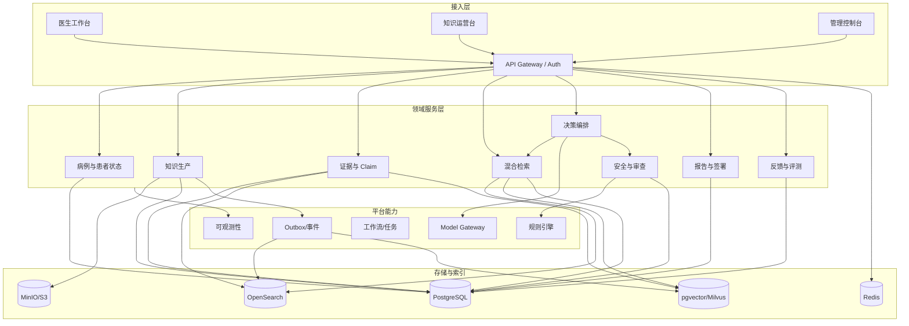

---

## 2. 知识生产与证据入库

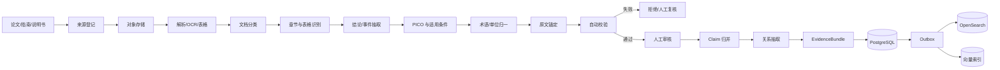

---

## 3. 临床决策流程

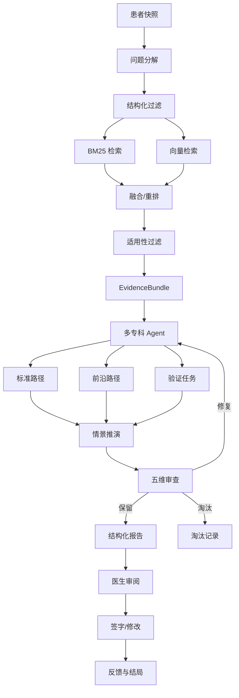

---

## 4. 数据存储分布

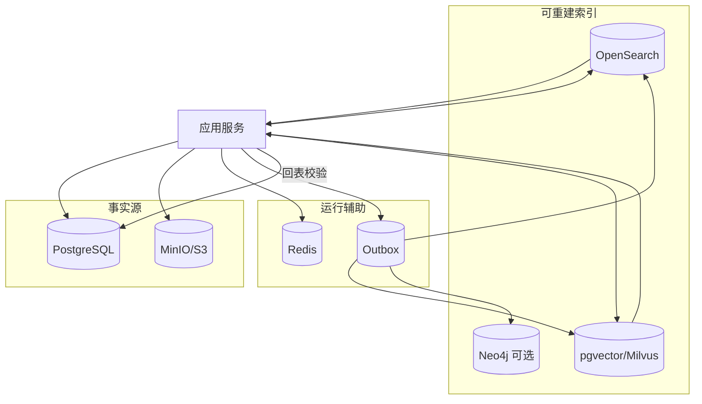

---

## 5. 证据与结论的数据关系

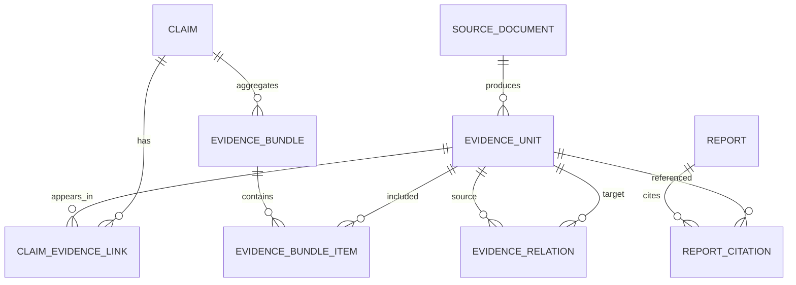

---

## 6. 部署拓扑

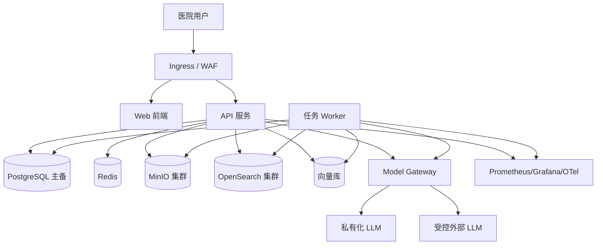

---

## 7. 请求链路

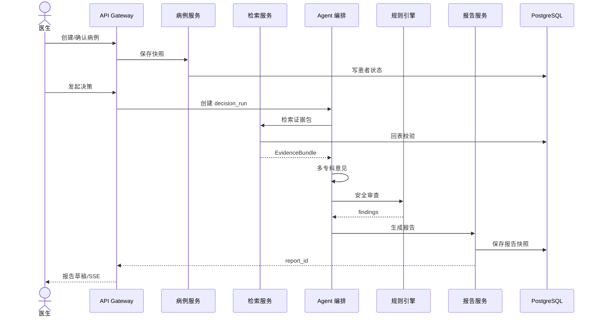

---

## 8. 索引同步与对账

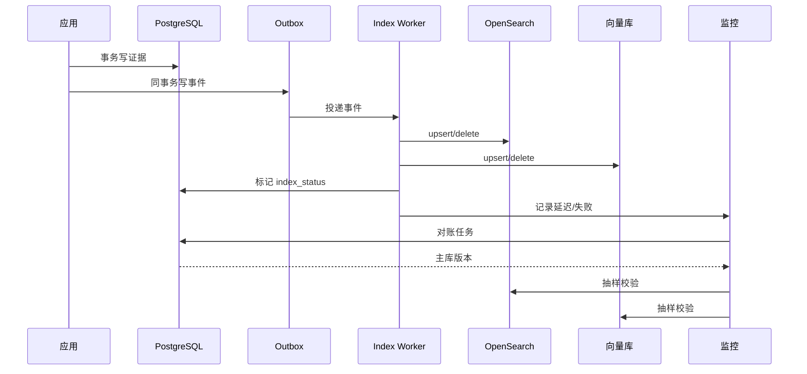

---

## 9. 评审修订补充（V0.2）

### 9.1 临床决策消融分支

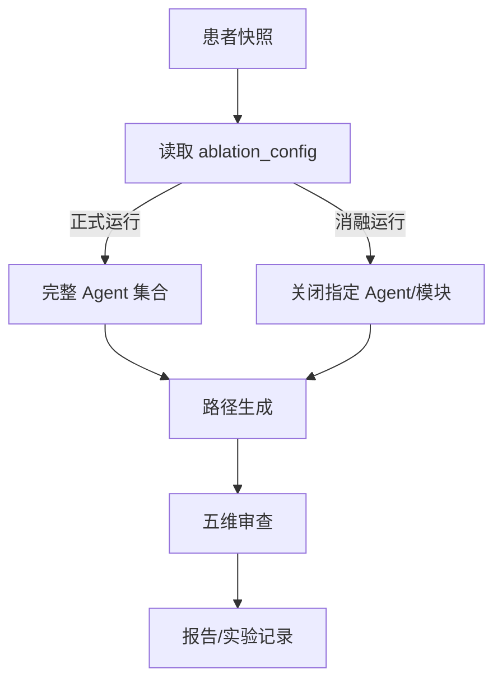

### 9.2 Outbox 死信分支

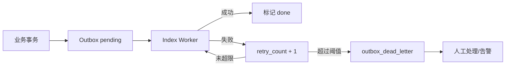

### 9.3 审计与 Outbox 实体补充

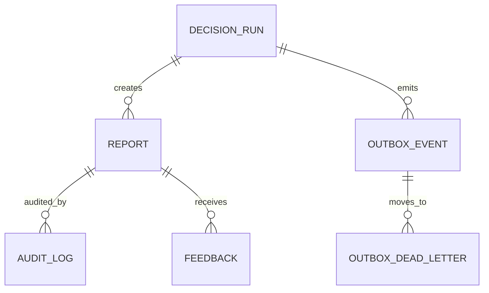

